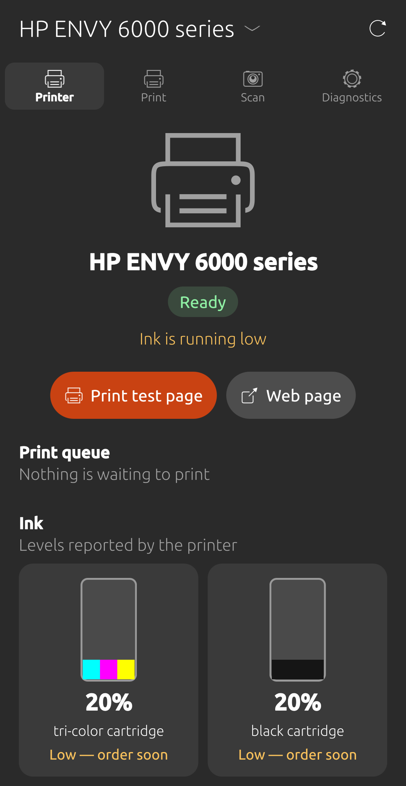
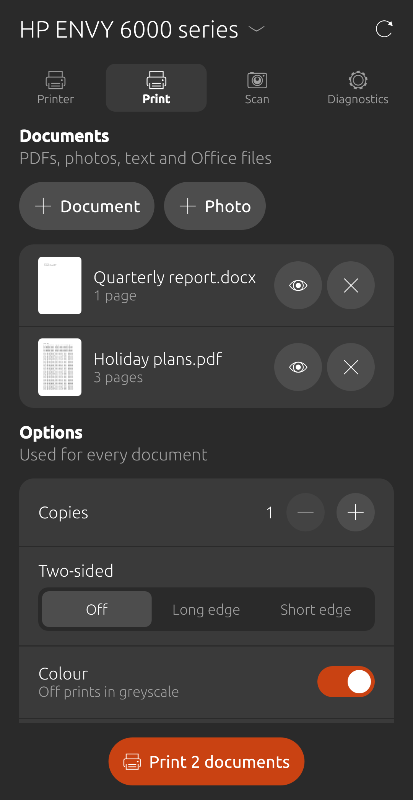
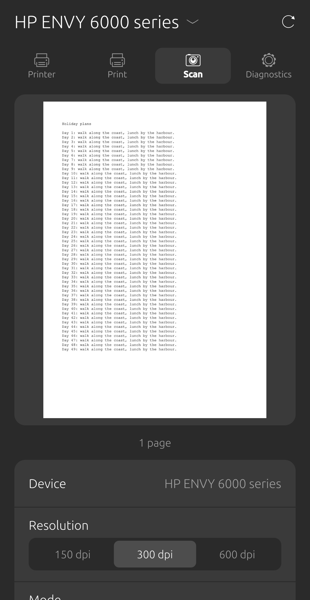
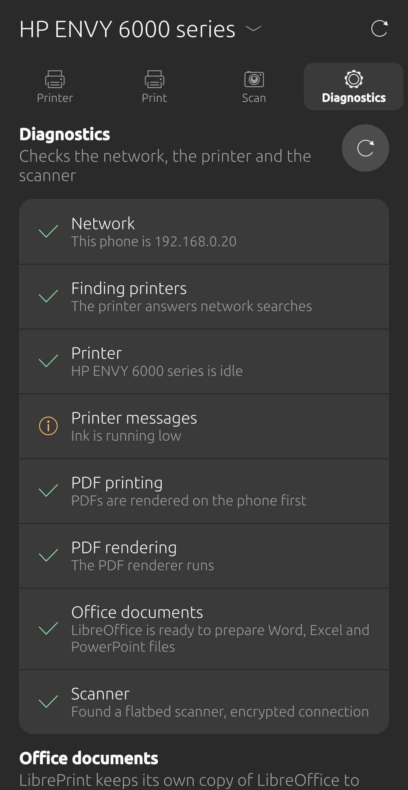

# LibrePrint for Ubuntu Touch

Print and scan from your phone with almost any modern network printer, with no drivers, and see its ink levels and print queue.

LibrePrint talks to the printer directly, over IPP for printing and eSCL for scanning, the standards behind AirPrint. It doesn't need CUPS, SANE, snaps or extra setup, and it runs fully confined.

<p>
  
  
  
  
</p>

## Features
- Finds printers on your Wi-Fi network, or connects by address
- Shows printer status and ink levels, with a low-ink warning
- Shows the print queue and lets you cancel one job or all of them
- Four tabs, like LibrePrint on the desktop: Printer, Print, Scan and Diagnostics
- Prints PDFs, photos, text and Office files, several at a time, with copies, page ranges, colour, two-sided and quality options where the printer supports them
- Shows a thumbnail, page count and full preview of each document before printing
- Prints from Document Viewer and other apps: use Share and choose LibrePrint
- Installs its own copy of LibreOffice on request, to prepare Word, Excel and PowerPoint files
- Scans from the flatbed in colour or greyscale, several pages to one PDF or to JPEGs, with a preview of every page
- Scans with the camera, with or without a scanner: finds the page, lets you drag its corners, straightens it, removes shadows, and adds it in colour, greyscale or black-and-white text
- Prints a test page showing colours, tones, fine lines and small text
- Diagnostics that check the network, printer, PDF rendering, Office support and scanner
- Opens the printer's own web page
- Renders PDFs on the phone for printers that can't read them, such as many home inkjets
- Converts images to JPEG when the printer can't read the original format

## Limits
- The printer must support driverless printing (IPP Everywhere or AirPrint)
- PDFs can only be rendered for printers that accept PWG Raster
- A printer reads a rendered PDF as it prints, so keep LibrePrint open until the last page has gone. The screen stays on for this, but Ubuntu Touch suspends apps you leave
- Office support is optional. Installing it downloads about 200 MB from The Document Foundation, checked against a fixed hash, and takes about 660 MB on the phone. It prepares documents only: it doesn't add the LibreOffice apps for editing
- Scanning uses the flatbed only, and needs an eSCL scanner. Document feeders aren't supported yet
- Scans save as PDF or JPEG, not PNG
- No USB printers
- A printer that offers no encryption is still used, unencrypted, and the Printer tab and Diagnostics say so

## Encryption
- LibrePrint prints over IPP over TLS (ipps) and scans over HTTPS whenever the printer offers it, trying TLS 1.2 or newer first. Older TLS is used only for printers that offer nothing better, and the app shows it
- Printers use self-signed certificates that no authority signs, so LibrePrint pins the certificate the first time it meets a printer (trust on first use, as CUPS does). Later it refuses a different certificate, on that port or any other port of the same printer, before sending anything
- A printer or scanner that once answered with encryption is never used unencrypted again, so blocking its encrypted port can't quietly move your documents or scans to a plain connection
- The Printer tab shows the certificate's SHA-256 fingerprint. Compare it with the one on the printer's own web page after adding the printer
- If you replace the printer's certificate yourself, forget the printer in the printer list and add it again
- mDNS printer discovery is plain multicast by design. It carries no document data

## Office files
Office files come from anywhere, so LibreOffice is kept on a short leash while it prepares them:
- The `office2pdf` helper installs a seccomp filter before LibreOffice loads, so the kernel refuses every internet socket for the conversion. A document can't fetch remote images or stylesheets, call a web service, or reach devices on your network, whatever LibreOffice's settings or bugs would allow. Without this, an HTML file's remote stylesheet was fetched during conversion
- Macros are switched off (`DisableMacrosExecution`, highest macro security) and links from untrusted documents are blocked, in the profile used for conversions
- It runs inside the app's AppArmor confinement, like the rest of LibrePrint
- The download is LibreOffice's official build. Its SHA-256 is pinned in `src/office.py` after checking The Document Foundation's GPG signature
- LibrePrint records which LibreOffice version is installed. When an app update ships a newer one, Diagnostics offers Update

## Permissions
- `networking`, to reach the printer and to download LibreOffice if you ask for it
- `content_exchange`, to receive files from other apps
- `content_exchange_source`, to hand scans to other apps
- `keep-display-on`, so the phone doesn't lock and suspend the app during a job

## Build
```
clickable build --arch arm64
```
The `pdf2pwg` and `office2pdf` helpers in `native/` are compiled, and Poppler is bundled with the app, so each architecture needs its own build.

## Test
```
python3 -m unittest discover -s tests
```

`tests/pwg_check.py` reads a raster file with libcups and compares its pages with `pdftoppm`.

`tests/fake_printer.py` is a small simulated printer for testing without paper or ink:
```
python3 tests/fake_printer.py --port 8631 [--tls]
```

## License
GPL-3.0. Ubuntu Touch edition of [LibrePrint](https://github.com/juujbyg/libreprint).

Certificate pinning and the TLS test printer follow Barry de Graaff's [Libreprint TLS](https://open-store.io/app/libreprint.barrydegraaff), a GPL-3.0 fork of this app.
